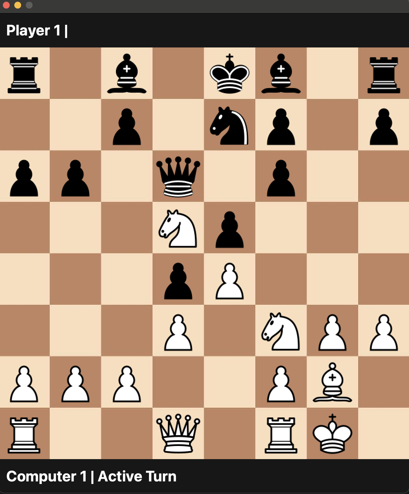

# AlanBot Chess AI

- **Presentation Layer:** Python PySide6 for drag and drop interface
  
- **Compute Engine:** Rust Maturin for Adversarial Search - Negamax with Quiescence Search with advanced pruning techniques such as Killer Move Heuristics, Static Exchange Evaluation, Late Move Reduction, Principal Variation Search, and Null-Move Pruning.

  The engine processes 24 + million nodes per second on Apple M4 Pro (8 Performance Threads) and averages 20+ depth on 15 second search. 

- **Move Generation:** BitBoard for board representation and BitBoard Magic Number to calculate moves for sliding pieces. 

- **Evaluation:** Self-trained NNUE (Dual-Perspective HalfKA) using Lichess FEN -> Score Positions.

- **NNuE Training:** Trained on [Lichess Chess Position Evaluations](https://huggingface.co/datasets/Lichess/chess-position-evaluations).

  The positions are filtered for Quiet Positions and the score is converted to a win percentage between [0 to 1] using a Sigmoid Function.

  The NNuE achieves an average of +/- 35 centipawns off stockfish for positions between -3.5 to 3.5 pawns and +/- 45 centipawns overall
  
## 1. Python Presentation & Validation Layer

- **PySide6 UI:** Renders a fluid 2D chessboard and manages real-time player drag-and-drop interactions

- **Move Validation:** Enforces legal moves and coordinates state synchronization with the rust compute engine

- **Opening Handbook:** Uses an opening handbook provided by [Chris Whittington](https://github.com/ChrisWhittington/polyglot-books/releases/latest/download/Performance.zip)

## 2. Rust Compute Engine

- **Bitboard Move Generation:** Uses 64-bit integers with fast AND / XOR logic to compute board occupancy. It also uses BitBoard Magic Number to instant compute sliding pieces moves and attacks.

- **Adversarial Search:** Implements Minimax (Negemax) adversarial search and uses Quiescence Search to extend the search for non-quiet positions to mitigate the horizon effect.

- **Advanced Pruning:** Uses Killer Move Heuristics, Late Move Reduction and Null-Move Pruning. to improve the Alpha / Beta cutoff. 

- **Deep Evaluation:** Combines Iterative Deepening with Principal Variation Search (PVS) to regularly achieve search depths of 16+ plies. (Average Move is approximately 22+ seconds).

- **Transposition Tables:** Caches previously evaluated board states to accelerate search paths in a lockless transposition Table. The tables uses the Condon-Thompson Replacement method to increase efficiency of L1 / L2 / L3 caches by prioritizng positions that are frequently traversed positions and evaluations with strong depth. 

- **Zobrist Hash:** Uses a unique 64-bit Zobrist Hashing for every board position and is incrementally updated using XOR operations; This is used for detecting three-move repetition and in the Transposition Table

- **Parallel Processing:** The search uses Lazy SMP (Symmetric Multiprocessing) which uses multiple search algorithms to independently process the same search evaluation agorithm and share position evaluations and cut-offs using a shared Lockless Transposition table.

- **Performance Benchmark:** Processes approximately 24+ million nodes per second (NPS) on an Apple M4 Pro chip. (8 Performance Core Only - 4.5 GHz + On-Chip Cache Memory - 39.5 MB)

## 3. Neural Network Evaluation

- **NNuE Architecture:** The engine features a customized **Dual-Perspective HalfKA King Bucket Model** perspective neural network utilizing a hybrid quantization layout. The architectural data pathways progress as follows:

  - **Input Preprocessing:** 
    - Convert to CentiPawn: ($\text{Centipawn / 100.0}$) -> pawn_units

  $$\text{Inputs (7040)} \rightarrow \text{Accumulator (256)} \rightarrow \text{Multiplexed Perspective (256*2)} \rightarrow \text{Hidden 2 (64)} \rightarrow \text{Hidden 3 (32)} \rightarrow \text{Output (1)}$$

  - **Input Layer:** $10 \times 11 \times 64 = 7040$ sparse features mapping active piece-square configurations relative to your own active King's position.
  - **Accumulator Layer:** Shapes into $(7040, 256)$ weights quantized to signed 16-bit integers (`i16`). Uses branchless tensor multiplexing to concatenate White/Black points of view into a unified $256$-dimensional vector.
    - *Activation:* Clipped/Bounded Linear ReLU ($\text{ReLU1}$) bounded strictly between `0.0` and `1.0`.
  - **Hidden Layer 2:** Matrix transformation mapping $(256*2, 64)$ quantized to signed 8-bit weights (`i8`) and 32-bit biases (`i32`).
    - *Activation:* Clipped/Bounded Linear ReLU ($\text{ReLU1}$) bounded strictly between `0.0` and `1.0`.
  - **Hidden Layer 3:** Matrix transformation mapping $(64, 32)$ quantized to signed 8-bit weights (`i8`) and 32-bit biases (`i32`).
    - *Activation:* Clipped/Bounded Linear ReLU ($\text{ReLU1}$) bounded strictly between `0.0` and `1.0`.
  - **Output Layer:** Combines $(32, 1)$ outputs down to a single evaluation scalar using 8-bit weights (`i8`) and 32-bit biases (`i32`).
    - *Activation:* None

## 4. NNUE Training

- **Training Data:** The model is trained on **394,669,566 chess positions** sourced from the [Lichess Chess Position Evaluations](https://huggingface.co/datasets/Lichess/chess-position-evaluations) dataset, which features evaluations calculated by Stockfish at various depths. To ensure an even and unbiased distribution, the training and validation sets utilize separate shards, and the training data is thoroughly shuffled.

- **Preprocessing & Data Preparation:**
  - **Quiet Position Filtering:** The dataset is filtered to include only "quiet" positions. Board states are excluded if the king is in check, an immediate tactical win is available via captures, or a forced checkmate sequence exists. It filter out all positions under Depth 26 to remove positions from 1 Second Blitz or 3 Minute Games.

  - **End Game Cleaning:** The dataset caps 8 piece positions with a 250 centipawn limit as these positions are augmented by promotion / check bonuses in Alpha-Beta Search. It also removes 600+ centipawn positions as they are often highly unstable.

  - **Data Augmentation & DeDuplication:** The filtered positions are augmented by rotating each board state 180 degrees. The positions are then deduplicationed. 
  
  This yields a total of **249,691,999 unique positions** - There is no phrase pruning, this is assuming this is a fair representation of X million chess games.

  ### **Key Validation Metrics & Phase Splits**

  The network architecture utilizes a lean 1.84-million parameter footprint. Governed by deep learning scaling laws optimized for alpha-beta search engines, the dataset pipeline targets an informational sweet spot of 60 to 80 million high-depth positions to ensure robust generalization and eliminate feature saturation. 

  Due to heavy native skews in the raw data pool, the data loader implements an out-of-core downscaling strategy. This architecture enforces a balanced, symmetrical distribution across the Early, Mid, and Late phases of the game, paired with a proportional King Bucket Mixture of Experts (MoE) extraction layer.

- **Training Configuration:**
    - **Target Optimization & Value Mapping:** The model transforms raw evaluation scores ($y_{\text{pawn}}$) into a bounded win probability scale $[0.0, 1.0]$, where 1.0 represents a guaranteed win, 0.5 a draw, and 0.0 a loss. This bounding suppresses extreme outliers and forces the network to focus its learning capacity on highly competitive positions.
    - **Loss Function:** Network performance is optimized using Mean Squared Error (MSE) between the predicted and target win probabilities: 
      $$\text{Win Probability} = \sigma(y_{\text{pawn}} \times 0.639607)$$
    - **Schedule & Batching Dynamics:** 
      * **Total Duration:** 30 epochs.
      * **Training Throughput:** 3,168 steps per epoch.
      * **Batch Size:** 8,192 positions per step.
      * **Validation Window:** 63 steps per epoch.
      * **Data Pipeline:** Datasets are systematically shuffled between epochs to prevent sequential memorization and overfitting.
    - **Learning Rate Dynamics:** Optimization utilizes the **AdamW** algorithm paired with a **CosineDecay** learning rate schedule, ensuring smooth, monotonic convergence toward the minimum floor ($\alpha = 2 \times 10^{-7}$).

- **Training Error:**
    * **Average Centipawn Error for positons +/- 3.5 Pawn Units**: 35 Centipawns
    * **Average Centipawn Error for All Positions**: 45 Centipawns

- cd nnue-training
- /train_pipeline.sh

## 5. Playing Level

The Chess AI has been tested against ELO 3200+ Chess.com bots - These bots are inflated and used primarily as a smoke test. 

- [WIN - ELO 3200 Bot](https://www.chess.com/analysis/game/computer/1617707258/analysis)
- [WIN - ELO 3200 Bot](https://www.chess.com/analysis/game/computer/1978599994/analysis)

- **Future Roadmap:** This engine has not been officially ratified by Computer Chess Rating Lists

## 6. Running the App

Playing as [black|white]
- /run.sh [black|white]

## 7. Contact

Alan Yuan

| Platform | Link | Intent |
| :--- | :--- | :--- |
| **Email** | [alan0408yuan@gmail.com](mailto:alan0408yuan@gmail.com) | Direct inquiries |
| **LinkedIn** | [linkedin.com](https://www.linkedin.com/in/alan-yuan-62301272/) | Professional networking |

*Response time: Typically within 24 hours.*
