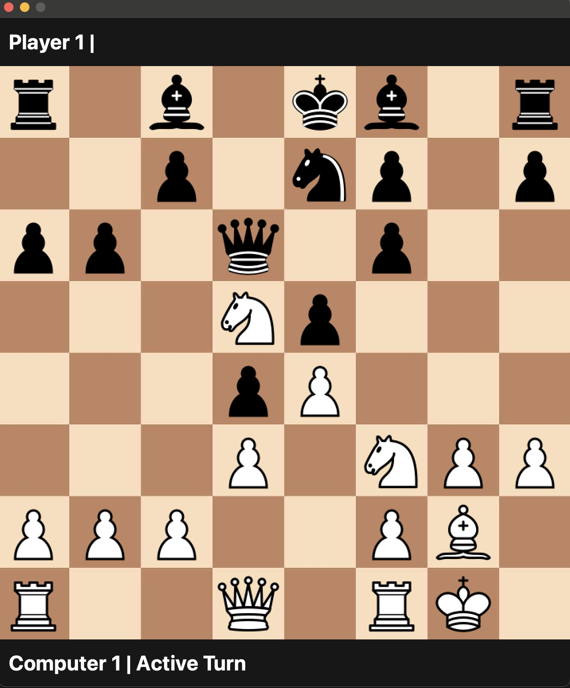

# AlanBot Chess AI

- **Presentation Layer:** Python PySide6 for drag and drop interface
  
- **Compute Engine:** Rust Maturin for Adversarial Search - Negamax with Quiescence Search with advanced pruning techniques such as Killer Move Heuristics, Static Exchange Evaluation, Late Move Reduction, Principal Variation Search, and Null-Move Pruning.

  The engine processes 20+ million nodes per second on Apple M4 Pro (8 Performance Threads) and averages 20+ depth on 15 second search. 

- **Move Generation:** BitBoard for board representation and BitBoard Magic Number to calculate moves for sliding pieces. 

- **Evaluation:** Self-trained NNUE (Dual-Perspective HalfKA) using Lichess FEN -> Score Positions.

- **NNuE Training:** Trained on [Lichess Chess Position Evaluations](https://huggingface.co/datasets/Lichess/chess-position-evaluations).

The positions are filtered for Quiet Positions and the score is converted to a win percentage between [0 to 1] using a Sigmoid Function.

The NNuE achieves an average of +/- 35 centipawns off stockfish for positions between -2.5 to 2.5 pawns.
  
## 1. Python Presentation & Validation Layer

- **PySide6 UI:** Renders a fluid 2D chessboard and manages real-time player drag-and-drop interactions

- **Move Validation:** Enforces legal moves and coordinates state synchronization with the rust compute engine

- **Opening Handbook:** Uses an opening handbook provided by [Chris Whittington](https://github.com/ChrisWhittington/polyglot-books/releases/latest/download/Performance.zip)

## 2. Rust Compute Engine

- **Bitboard Move Generation:** Uses 64-bit integers with fast AND / XOR logic to compute board occupancy. It also uses BitBoard Magic Number to instant compute sliding pieces moves and attacks.

- **Adversarial Search:** Implements Minimax (Negemax) adversarial search and uses Quiescence Search to extend the search for non-quiet positions to mitigate the horizon effect.

- **Advanced Pruning:** Uses Killer Move Heuristics, Late Move Reduction and Null-Move Pruning. to improve the Alpha / Beta cutoff. 

- **Deep Evaluation:** Combines Iterative Deepening with Principal Variation Search (PVS) to regularly achieve search depths of 16+ plies. (Average Move is approximately 22+ seconds).

- **Transposition Tables:** Caches previously evaluated board states to accelerate search paths in a lockless transposition Table. The tables uses the Condon-Thompson Replacement method to increase efficiency of L1 / L2 / L3 caches by prioritizng positions that are frequently traversed positions and evaluations with strong depth. 

- **Zobrist Hash:** Uses a unique 64-bit Zobrist Hashing for every board position and is incrementally updated using XOR operations; This is used for detecting three-move repetition and in the Transposition Table

- **Parallel Processing:** The search uses Lazy SMP (Symmetric Multiprocessing) which uses multiple search algorithms to independently process the same search evaluation agorithm and share position evaluations and cut-offs using a shared Lockless Transposition table.

- **Performance Benchmark:** Processes approximately 24+ million nodes per second (NPS) on an Apple M4 Pro chip. (8 Performance Core Only - 4.5 GHz + On-Chip Cache Memory - 39.5 MB)

## 3. Neural Network Evaluation

- **NNuE Architecture:** The engine features a customized **Dual-Perspective HalfKA Horizontally Mirrored** perspective neural network utilizing a hybrid quantization layout. The model accounts for caslting. The architectural data pathways progress as follows:

- **Input Preprocessing:** The engine convert to CentiPawn: ($\text{Centipawn / 100.0}$) -> pawn_units

$$\text{Inputs (22532)} \rightarrow \text{Accumulator (256)} \rightarrow \text{Multiplexed Perspective (256*2)} \rightarrow \text{Hidden 2 (64)} \rightarrow \text{Hidden 3 (32)} \rightarrow \text{Output (1)}$$

- **Input Layer:** $32 \times 11 \times 64 \plus 4 = 22532$ sparse features mapping active piece-square configurations relative to your own active King's position.
- **Accumulator Layer:** Shapes into $(22532, 256)$ weights quantized to signed 16-bit integers (`i16`). Uses branchless tensor multiplexing to concatenate White/Black points of view into a unified $256$-dimensional vector.
  - *Activation:* Clipped/Bounded Linear ReLU ($\text{ReLU1}$) bounded strictly between `0.0` and `1.0`.
- **Hidden Layer 2:** Matrix transformation mapping $(256*2, 32)$ quantized to signed 8-bit weights (`i8`) and 32-bit biases (`i32`).
  - *Activation:* Clipped/Bounded Linear ReLU ($\text{ReLU1}$) bounded strictly between `0.0` and `1.0`.
- **Hidden Layer 3:** Matrix transformation mapping $(32, 32)$ quantized to signed 8-bit weights (`i8`) and 32-bit biases (`i32`).
  - *Activation:* Clipped/Bounded Linear ReLU ($\text{ReLU1}$) bounded strictly between `0.0` and `1.0`.
- **Output Layer:** Combines $(32, 1)$ outputs down to a single evaluation scalar using 8-bit weights (`i8`) and 32-bit biases (`i32`).
  - *Activation:* None

## 4. NNuE Training

- **Training Data:** The model is trained on 1+ billion positions sourced from the [Lichess Chess Position Evaluations](https://huggingface.co/datasets/Lichess/chess-position-evaluations) dataset, which features evaluations calculated by Stockfish at various depths. To ensure an even and unbiased distribution, the training and validation sets utilize separate shards, and the training data is thoroughly shuffled.

- **Quiet Position Filtering:** The dataset is filtered to include only "quiet" positions. Board states are excluded if the king is in check, an immediate tactical win is available via captures, or a forced checkmate sequence exists. 

If the current player or the opponent can gain a tactical advantage via a capture chain on the immediate board, we assume this isn't a quiet position.

- **Depth Cleaning:** The dataset includes positions evaluated for 5+ minute deep analysis on depth 60+ and shallow games on mobile - These edge cases are unsuitable for training. However, if there are multiple positions, we priorize the deeper position.

- **Multi PV-Mode:** There are positions that force the engine to calcuate multiple PV alternative PV lines for a position on the same depth - If there multiple evaluations for the same position on the same depth, we assume the engine choose the best evaluation. We also assume the best line is included

- **Data Augmentation & DeDuplication:** The filtered positions are augmented by rotating each board state 180 degrees to duplicate training positions and to reduce White/ Black Bias

This yields a total of **260,472,584 unique positions**.

- **Target Optimization & Value Mapping:** The model transforms raw evaluation scores ($y_{\text{pawn}}$) into a bounded win probability scale $[0.0, 1.0]$, where 1.0 represents a guaranteed win, 0.5 a draw, and 0.0 a loss. This bounding suppresses extreme outliers and forces the network to focus its learning capacity on highly competitive positions.

- **Loss Function:** Network performance is optimized using Mean Squared Error (MSE) between the predicted and target win probabilities: $$\text{Win Probability} = \sigma(y_{\text{pawn}} \times 0.639607)$$

- **Schedule & Batching Dynamics:** 
  * **Total Duration:** 30 epochs.
  * **Training Size:** 247,453,231
  * **Validation Size:** 13,019,353
  * **Batch Size:** 8,192 positions per step.
- **Training Error:**
  * **Average Centipawn Error for positons +/- 2.5 Pawn Units**: 25 Centipawns

### 5. Synchronized Optimization Schedules

The network is trained using a three-stage optimization and data-filtering strategy designed to maximize positional accuracy inside a compact `32 -> 32` architecture:

* **Optimizer (`AdamW`):** Uses decoupled weight decay (`1e-5`) to prevent rarely visited king buckets from drifting on noisy gradients, alongside `epsilon=1e-5` and `global_clipnorm=1.0` to stabilize sparse feature updates against sharp tactical outliers.
* **Adaptive Learning Rate (`Newbob`):** Starts at `1.0e-3` for rapid initial feature organization and halves the learning rate whenever validation loss fails to improve by at least `0.0001` (down to a floor of `1.0e-5`), allowing weights to settle smoothly into flat minima.
* **Centipawn Curriculum Filtering:** 
  * **Warmup (Epochs 1–3):** Trains on all positions (`strength = 0.0`) so the model first learns fundamental material values and decisive advantages.
  * **Annealing (Epochs 3–18):** Linearly ramps filtering strength from `0.0` to `1.0` using a Lorentzian keep-rate curve (`1 / (1 + (cp / scale_cp)^2)`), progressively discarding lopsided blowouts (`>500 cp`) so the narrow hidden layer focuses its capacity on subtle, balanced positions (`0–225 cp`).

## 6. Playing Level

The Chess AI has been tested against ELO 3200+ Chess.com bots - These bots are inflated and used primarily as a smoke test. 

- [WIN - ELO 3200 Bot](https://www.chess.com/analysis/game/computer/1617707258/analysis)
- [WIN - ELO 3200 Bot](https://www.chess.com/analysis/game/computer/1978599994/analysis)

- **Future Roadmap:** This engine has not been officially ratified by Computer Chess Rating Lists

## 7. Running the App

Playing as [black|white]
- /run.sh [black|white]

## 8. Contact

Alan Yuan

| Platform | Link | Intent |
| :--- | :--- | :--- |
| **Email** | [alan0408yuan@gmail.com](mailto:alan0408yuan@gmail.com) | Direct inquiries |
| **LinkedIn** | [linkedin.com](https://www.linkedin.com/in/alan-yuan-62301272/) | Professional networking |

*Response time: Typically within 24 hours.*
